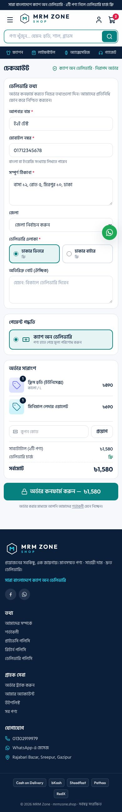
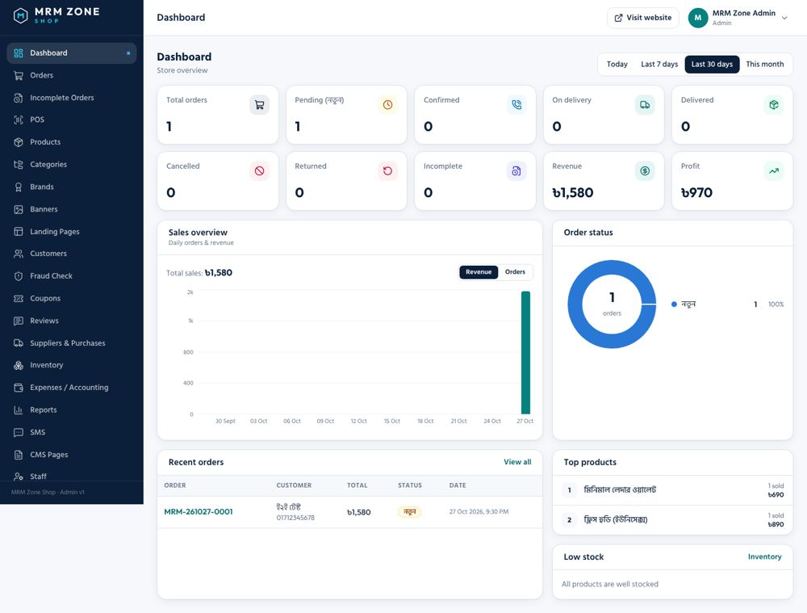

# MRM Zone Shop

**প্রয়োজনের সবকিছু, এক জায়গায়** — সম্পূর্ণ ই-কমার্স প্ল্যাটফর্ম: স্টোরফ্রন্ট, অ্যাডমিন প্যানেল, কুরিয়ার ইন্টিগ্রেশন, অ্যাকাউন্টিং।

| ফোল্ডার | কী | টেকনোলজি |
|---|---|---|
| `backend/` | REST API — ওয়েবসাইট, অ্যাডমিন ও ভবিষ্যতের মোবাইল অ্যাপের জন্য | Laravel 12, PHP 8.3, MySQL, Sanctum |
| `web/` | স্টোরফ্রন্ট (বাংলা) + `/admin` প্যানেল | Next.js 15, React 19, TypeScript, Tailwind |
| `deploy/` | Caddy (অটো HTTPS), ব্যাকআপ ও আপডেট স্ক্রিপ্ট | Docker Compose |
| `docs/` | API কন্ট্র্যাক্ট, VPS ডিপ্লয় গাইড, মোবাইল অ্যাপ পরিকল্পনা | |

## ফিচার

**স্টোরফ্রন্ট:** হোম (ব্যানার, ক্যাটাগরি, সেকশন), ক্যাটাগরি ফিল্টার/সর্ট, সার্চ, প্রোডাক্ট পেজ (গ্যালারি, সাইজ/রঙ ভ্যারিয়েন্ট, সাইজ চার্ট, রিভিউ), কার্ট, এক পেজের COD চেকআউট (কুপন, ঢাকার ভেতরে/বাইরে চার্জ, ফ্রি ডেলিভারি), অর্ডার ট্র্যাকিং, Facebook অ্যাডের জন্য ল্যান্ডিং পেজ, কাস্টমার অ্যাকাউন্ট ও উইশলিস্ট, Meta Pixel, পলিসি পেজ।

**অ্যাডমিন:** ড্যাশবোর্ড (স্ট্যাটাস কার্ড, সেলস চার্ট, টপ প্রোডাক্ট, লো স্টক), অর্ডার ম্যানেজমেন্ট (স্ট্যাটাস ট্যাব, বাল্ক অ্যাকশন, এডিট, ইনভয়েস প্রিন্ট), অসম্পূর্ণ অর্ডার, POS, Steadfast / Pathao / RedX বুকিং ও অটো স্ট্যাটাস সিঙ্ক, ফ্রড চেক ও ব্ল্যাকলিস্ট, প্রোডাক্ট ও ভ্যারিয়েন্ট, ক্যাটাগরি, ব্র্যান্ড, ব্যানার, কুপন, ল্যান্ডিং পেজ বিল্ডার, রিভিউ, সাপ্লায়ার ও পারচেজ (স্টক ইন), স্টক মুভমেন্ট, খরচ ও লাভ-ক্ষতি রিপোর্ট, SMS (অটো + বাল্ক), CMS পেজ, স্টাফ রোল (admin / manager / staff), অ্যাক্টিভিটি লগ, সেটিংস।

## স্ক্রিনশট

| স্টোর (মোবাইল) | চেকআউট | অ্যাডমিন ড্যাশবোর্ড |
|---|---|---|
|  |  |  |

ডেমো মোড (ব্যাকএন্ড ছাড়া দেখতে): `web/.env.local`-এ `NEXT_PUBLIC_DEMO_MODE=true` → অ্যাডমিন লগইন `admin@mrmzone.shop` / `demo`।

## লোকালি চালানো

```bash
# API
cd backend
composer install
cp .env.example .env   # লোকালে DB_CONNECTION=sqlite করে নিতে পারেন
php artisan key:generate && php artisan migrate --seed
php artisan serve                     # http://localhost:8000

# ওয়েবসাইট
cd ../web
npm install
cp .env.example .env.local            # NEXT_PUBLIC_API_URL=http://localhost:8000/api/v1
npm run dev                           # http://localhost:3000
```

টেস্ট: `cd backend && php artisan test` (বা `vendor/bin/phpunit`)

## ডিপ্লয়

Contabo VPS-এ চালু করার ধাপে ধাপে গাইড: **[docs/DEPLOY_CONTABO.md](docs/DEPLOY_CONTABO.md)**

API ডকুমেন্টেশন: [docs/API.md](docs/API.md) · মোবাইল অ্যাপ পরিকল্পনা: [docs/MOBILE_APP.md](docs/MOBILE_APP.md)

---
© MRM Zone · ট্রেড লাইসেন্স 20262201004730
